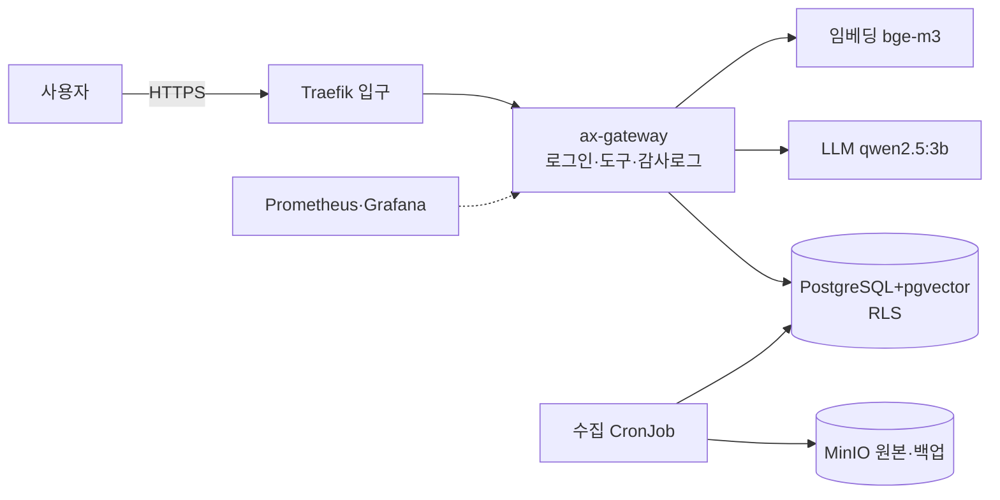

# AX Platform Lab 핵심 요약본 — 하루 2회독 벼락치기

## 0. 이 요약본 사용법

| 회독 | 시간 | 방법 |
|---|---|---|
| **1회독** | 2~3시간 | 1~6장을 정독한다. 각 절의 **"면접 한 줄"과 굵은 수치**에 형광펜을 긋는다. 5장 질문은 소리 내어 답해 본다 |
| **2회독** | 1시간 | 굵은 글씨와 표만 훑는다 → 7장 퀴즈 30문항을 정답 없이 풀고 틀린 것만 해당 절로 돌아가 다시 읽는다 |
| 면접 직전 | 15분 | 1장 수치표 + 4장 사례 5개 + 6장 자기소개 뼈대 |

> 원칙: **수치로 말한다 · 직접 한 것과 공부한 것을 구분한다 · 모르면 아는 척하지 않는다.**

---

## 1. 프로젝트 한눈에

### 30초 소개 (외워서 말하기)
> "에티버스그룹 AXhub처럼 사내 AI가 문서를 읽되 **직원 권한 범위 안에서만 답하는 플랫폼**을 쿠버네티스 GPU 인프라에 직접 구축했습니다. 가상 제조사 데이터로 sLLM, 문서 검색(RAG), AI 에이전트를 올리고, **앱 필터와 DB 행 수준 보안 두 겹**으로 권한을 막았습니다. 인터넷이 막힌 상태에서 **15분 만에 재설치하는 폐쇄망 리허설**, 모니터링·알람, **백업 복구 훈련**, **장애 8종 진단**, 고객 **사이징 제안서**까지 했고 모든 결과를 수치로 남겼습니다."

### 구성

- **노드 4대**: control-plane(입구·인증서) / app(게이트웨이·화면·모니터링) / **gpu**(LLM·임베딩, taint) / **data**(DB·MinIO, taint)
- 모든 Pod 간 통신은 **기본 거부**, 필요한 경로만 허용

### 핵심 수치 (반드시 암기)
| 무엇 | 수치 | 의미 |
|---|---|---|
| 권한 자동 테스트 | **14/14** | 같은 질문 4개 역할, 범위가 다름 |
| 권한 필터 사고 | **유출 0건** | 앱 필터가 꺼져도 RLS가 막음 (작업자 0 / 품질 25) |
| NetworkPolicy | 적용 전 **9개 열림** → **14/14** | 기본 거부 + 허용 목록 |
| 폐쇄망 재구축 | **15분 21초**, 번들 **7.5GB** | 이미지 16종 + 모델 2.9GB + SHA256 |
| 복구 훈련 | **RTO 48초 / RPO 36초** | 백업 이후 데이터는 실제로 사라짐 |
| CPU 벤치 | 동시 4개 처리량 **34.8 토큰/s** (2.2배), 동시 8개 **TTFT p95 13초** | 슬롯 초과 → 대기열 |
| 알람 | **11종**, 대기열 5 > 4 → **TTFT p95 약 1분** | 실제로 울려 봄 |
| 사이징 | 32B FP8 · 동시 30건 = **70.6GB** (가중치 32 + KV **32.2** + 여유 6.4) → **L40S 2장** | **KV 캐시가 가중치만큼 크다** |
| 검색 거리 기준 | **0.56** (관련 0.37~0.55 / 무관 0.58~0.67) | 실측으로 정함 |
| 데이터 | 문서 18 → 청크 **138**, 1024차원 | 제목 단위, 700자/겹침 100 |

### 같은 질문 "3호기 E-203 대응 방법과 최근 정비 이력"의 역할별 결과
| 작업자 | 정비원 | 품질 | 관리자 |
|---|---|---|---|
| 안전 규정·요청 절차 + **정비 요청서 초안**, 이력 **거부** | 3호기 매뉴얼 + 이력 4건 + 재고(센서 0개) | 품질 보고서만, 이력 **거부** | 전부 |

---

### 모듈별로 무엇을 했고 무엇을 얻었나
| 모듈 | 한 일 | 얻은 것 (면접에서 쓰는 한 문장) |
|---|---|---|
| M0 환경 | WSL2·Docker·GPU 점검 | 컨테이너 안 GPU 인식 확인, VRAM 여유 3GB라 **3B 모델**을 근거 있게 선택 |
| M1 클러스터 | kind 4노드, Calico, taint | toleration 없는 GPU Pod의 **Pending 사유를 노드별로 읽는 법** |
| M2 서빙 | Ollama 차트, 벤치마크 | **슬롯을 넘으면 TTFT가 먼저 무너진다**(동시 8개 13초), 모델 적재 **교착** 해결 |
| M3 데이터 | 가상 문서, pgvector, MinIO, 수집 | 제목 단위 청크, **의미 검색만으로는 호기를 구분 못 한다** |
| M4 권한 RAG ★ | 게이트웨이, 도구 4개, RLS | **앱 + DB 두 겹 권한**, 근거 없으면 "모름", 테스트 14/14 |
| M5 네트워크 | Traefik·TLS, NetworkPolicy, 폐쇄망 | **기본 거부 14/14**, 인터넷 없이 **15분 21초** 재구축 |
| M6 모니터링 | Prometheus·Grafana·알람 | **대기열 → TTFT 악화**를 지표로 확인, CPU throttling 진단 |
| M7 백업 | pg_dump → MinIO, 복구 훈련 | **RTO 48초 / RPO 36초** 실측, "복구해 봐야 백업" |
| M8 장애 | 장애 8종 주입·진단 | OOM·모델 이름·GPU 부족·**권한 유출 조사**, 런북 8개 |
| M9 사이징 | 계산기, RFP 제안서 | **KV 캐시가 가중치만큼 크다** → GPU 수는 동시성이 결정 |

## 2. 핵심 용어 사전

### 2-1. 인프라 기초
| 용어 | 쉬운 설명 | 비유 |
|---|---|---|
| 커널 | OS의 핵심. CPU·메모리·장치를 프로그램에 나눠 줌. GPU 드라이버는 커널 모듈 | 관리사무소 소장 |
| VM | 하이퍼바이저 위에 OS를 통째로 하나 더 띄운 가짜 컴퓨터 | 건물 안에 집 한 채 |
| **컨테이너** | 커널을 공유하며 **namespace(격리)**와 **cgroup(자원 제한)**으로 나눈 프로세스 | 조립식 방 |
| 이미지 | 컨테이너를 만드는 틀(여러 층의 읽기 전용 파일) | 붕어빵 틀 |
| **GPU 스택 3층** | **드라이버**(호스트) → **CUDA**(이미지 안) → **Container Toolkit**(둘을 연결). 드라이버가 지원하는 CUDA ≥ 이미지 CUDA | 배선 → 가전 → 콘센트 기사 |
| BMC (iDRAC/iLO) | OS가 죽어도 원격으로 전원·콘솔·펌웨어를 다루는 관리용 칩 | 원격 관제실 |
| 베어메탈 | 가상화 없이 서버에 OS 직접 설치 | 맨땅의 건물 |
| namespace | 프로세스가 볼 수 있는 범위(PID·네트워크·파일)를 나누는 커널 기능 | 방 칸막이 |
| cgroup | CPU·메모리 사용량 상한을 거는 커널 기능 | 방별 차단기 용량 |
| 컨테이너 런타임 (containerd/CRI-O) | 노드에서 컨테이너를 실제로 만드는 프로그램. 쿠버네티스는 CRI로 대화 | 장비 자체 |
| 패스스루 / vGPU | GPU를 VM 하나에 통째로 / 라이선스로 쪼개 여러 VM에 | 전용석 / 합석 |
| NVLink | 같은 서버 GPU끼리 PCIe보다 훨씬 빠르게 연결하는 전용 링크 | 수술실 사이 직통 문 |

### 2-2. 쿠버네티스
| 용어 | 쉬운 설명 | 비유 |
|---|---|---|
| **선언형 / 조정 루프** | 원하는 상태를 선언하면 컨트롤러가 실제 상태를 계속 비교해 맞춤 | "환자 3명 유지" 지시 |
| API 서버 / etcd | 모든 요청의 창구 / 상태 저장소(과반수 합의 → 3·5대 홀수) | 대표 창구 / 기록실 |
| 스케줄러 | 새 Pod를 둘 노드 결정(필터링 → 점수) | 접수처 |
| kubelet | 노드에서 컨테이너를 실제 실행·검사·보고 | 담당 간호사 |
| **Pod** | 배치 최소 단위(컨테이너 묶음) | 환자 |
| Deployment / **StatefulSet** / DaemonSet / Job·CronJob | 무상태 앱 / **이름·디스크 고정(DB)** / 노드마다 하나 / 일회성·주기 작업 | 교대 근무 / 지정 병실 / 소화기 / 심부름 |
| **Service** | Pod 앞의 고정 주소. **Ready Pod에만** 트래픽 | 대표 내선번호 |
| **라벨+nodeSelector / taint+toleration** | Pod가 노드를 고름(끌어당김) / 노드가 Pod를 거름(밀어냄). GPU 노드는 둘 다 | 간판 / "예약 환자만"+예약증 |
| **requests / limits** | 스케줄링 기준 / 실행 중 상한. 메모리 초과 → **OOMKilled**, CPU 초과 → **throttling** | 예약 침대 / 퇴실 기준 |
| 확장 리소스 / **device plugin** / **GPU Operator** | `nvidia.com/gpu` 개수 광고 / GPU 탐지·등록·할당 / 드라이버~모니터링 일괄 관리 | MRI 대수 / 장비 대장 담당 / 개설 패키지 |
| **Probe 3종** | startup(켜졌나) / **readiness(트래픽 받을까, 실패 시 제외)** / liveness(살아 있나, 실패 시 재시작) | 출근 / 진료 준비 / 쓰러짐 |
| PVC / StorageClass / CSI | 디스크 요청서 / 디스크 만드는 규칙 / 외부 스토리지 표준 | 사물함 신청서 / 업체 / 규격 |
| Helm | 템플릿+값으로 배포를 패키지·버전 관리. **배포 성공 ≠ 서비스 정상** | 개설 패키지 주문서 |
| HPA | CPU 사용률로 Pod 수 자동 조정 | 창구 더 열기 |
| QoS 클래스 | requests=limits면 Guaranteed, 아니면 Burstable/BestEffort. 메모리 부족 시 BestEffort부터 축출 | 진료 우선순위 |
| ResourceQuota | 네임스페이스별 자원(GPU 포함) 총량 상한 | 부서별 병상 한도 |
| EndpointSlice | Service가 트래픽을 보낼 Ready Pod 주소 목록 | 근무 중 상담원 명단 |
| headless Service | 대표 IP 없이 DNS가 Pod IP를 바로 줌. publishNotReadyAddresses면 NotReady도 포함 | 직원용 직통 번호 |
| Recreate / RollingUpdate | 옛 Pod를 먼저 지우고 새로 / 새 Pod를 띄우며 교체(무중단). GPU·RWO 디스크는 Recreate | 전원 교대 / 순차 교대 |
| field manager (SSA) | 필드마다 누가 관리하는지 기록. Helm 리소스를 kubectl로 고치면 충돌 | 결재선 |

### 2-3. AI·LLM
| 용어 | 쉬운 설명 | 비유 |
|---|---|---|
| 토큰 | 모델이 다루는 글 단위(단어 조각) | 음절 |
| **프리필 / 디코드** | 입력을 한 번에 읽음(**TTFT** 좌우) / 토큰을 하나씩 생성(**토큰/초** 좌우, 메모리 대역폭 병목) | 문진 / 설명 |
| 파라미터 | 학습으로 익힌 숫자 개수(3B=30억) | 뇌세포 수 |
| **양자화** | 숫자 하나의 비트를 줄여 모델 축소(FP16 2B → FP8 1B → INT4 0.5B). 메모리·속도↑, 정확도 약간↓ | 압축 JPG |
| **KV 캐시** | 앞 토큰의 중간 결과 저장. **컨텍스트 × 동시 요청에 비례** | 진료 메모장 |
| GQA / PagedAttention | KV 헤드 공유로 KV 절약 / KV를 페이지 단위로 할당해 처리량↑(vLLM) | – |
| **TTFT / p95** | 첫 토큰까지 시간 / 100건 중 95번째로 느린 값(체감 기준) | 첫마디까지 |
| continuous batching | 끝난 요청 자리에 새 요청을 바로 끼움(vLLM) | 빈 진료실 즉시 배정 |
| 임베딩 | 문장 → 의미 좌표(벡터). bge-m3 1024차원. **문서·질문은 같은 모델** | 도서관 좌표 |
| 코사인 거리 | 1 − 방향 유사도. 0에 가까울수록 비슷 | 화살표 각도 |
| **RAG** | 관련 사내 문서를 찾아 LLM에 근거로 주고 답하게 함 | 오픈북 시험 |
| 환각 | 모르는 걸 그럴듯하게 지어냄 | 아는 척하는 신입 |
| 청크 / 겹침 | 문서 조각 / 경계 문장 보존용 중복 | 필요한 페이지 복사 |
| HNSW | 이웃 그래프로 빠른 근사 벡터 검색(메모리 많이 씀) | 시→구→동 좁혀 찾기 |
| **에이전트 / 도구 호출** | 필요한 도구를 골라 실행하고 결과로 답함 | 부서를 다녀오는 비서 |
| 서빙 엔진 | Ollama(쉬움·CPU 가능) / **vLLM**(운영 처리량) / Triton(다종 모델) | 동네 의원 / 대형 병원 |
| GGUF / AWQ / GPTQ | Ollama·llama.cpp용 양자화 파일 형식 / 중요한 가중치를 보호하는 4비트 양자화 방법들 | 압축 포맷 |
| 텐서 병렬 (TP) | 모델 한 벌을 여러 GPU에 쪼개 올림. 통신이 많아 같은 서버 안(NVLink) | 큰 수술을 둘이 나눠 |
| 컨텍스트 길이 | 한 요청에서 모델이 보는 최대 토큰(질문 + 근거 + 답변) | 펼칠 수 있는 차트 쪽수 |
| 프롬프트 인젝션 | "이전 지시 무시하고…" 같은 공격. 권한 밖 문서가 검색에 없으면 볼 수 없음 | 사칭 전화 |

### 2-4. 보안·네트워크
| 용어 | 쉬운 설명 |
|---|---|
| 인증 / 인가 | 누구인가 / 무엇을 할 수 있나 |
| JWT | 서명된 로그인 토큰. 위조 불가지만 **내용은 누구나 읽음** |
| RBAC | 권한을 사람이 아닌 **역할**에 묶음 |
| **RLS** | DB가 행 단위로 접근을 강제. 앱이 `SELECT *`해도 허용 행만 |
| **다층 방어** | 앱(설명·기록) + DB(강제) 두 겹 |
| 감사 로그 | 누가·언제·무엇을 묻고·어떤 문서·도구·거부·결과 |
| 최소 권한 | 일에 필요한 권한만 (계정 4개 분리) |
| L4 / L7 | IP·포트만 보고 전달 / HTTP 경로까지 보고 판단 |
| CNI / kube-proxy / CoreDNS | Pod 네트워크 / Service IP → Pod 변환 / 이름 → IP |
| **Ingress** | 외부 HTTP를 경로별로 서비스에 전달(L7 입구). ingress-nginx 은퇴(2026-03) → Traefik, 장기적으로 Gateway API |
| **TLS / 사설 CA** | 암호화 + 서버 인증 / 회사가 운영하는 인증서 발급 기관 |
| **NetworkPolicy** | Pod 간 통신 허용 목록. **기본은 모두 허용** → 기본 거부부터 |
| **폐쇄망** | 인터넷 없는 내부망. 모든 것을 사전 **반입**, SHA256 검증, 오프라인 리허설 |
| 내부 레지스트리 | 사내 이미지 창고(Harbor). 폐쇄망 정석, **digest 보존** |
| 망 분리 4종 | 관리망 / 서비스망 / 스토리지망 / GPU 연산망 |
| **InfiniBand / RoCEv2** | RDMA 전용망(손실 없음·저지연) / 이더넷 위 RDMA(기존 장비, PFC·ECN 튜닝 필요) |
| Spine-Leaf | 모든 Leaf가 모든 Spine에 연결 → 경로 길이 일정, Spine으로 확장 |
| RDMA | CPU·OS를 거치지 않고 다른 서버 메모리에 직접 읽고 쓰기(저지연) |
| Gateway API | Ingress의 후속 표준. 인프라(Gateway)와 앱(HTTPRoute) 역할 분리 |
| SAN (dnsNames) | 인증서가 유효한 이름 목록. 접속 주소와 맞아야 함 |
| 멀티 아키텍처 이미지 | 한 이름 아래 amd64·arm64 이미지를 묶은 목차(index) |
| 이레이저 코딩 | 데이터를 조각 + 패리티로 나눠 저장, 일부 디스크가 고장 나도 복원(MinIO 분산) |
| Object Lock (WORM) | 객체를 기간 동안 수정·삭제 불가로 잠금 → 불변 백업 |

### 2-5. 운영
| 용어 | 쉬운 설명 |
|---|---|
| 황금 신호 4개 | 지연 · 트래픽 · 오류 · 포화 |
| Prometheus | /metrics를 주기적으로 가져오는(pull) 지표 저장·알람 시스템 |
| Counter / Gauge / Histogram | 증가만(→ `rate`) / 오르내림 / 구간 분포(→ `histogram_quantile`) |
| pending / firing | 조건 충족 후 지속 대기 / 실제 발생 |
| runbook | 알람·장애별 대응 매뉴얼 |
| **DCGM / Xid** | GPU 지표 수집 도구 / GPU 오류 번호(**79 버스 이탈, 48 이중 비트 ECC, 31 페이지 폴트**) |
| **RPO / RTO** | 잃어도 되는 데이터 범위(백업 주기) / 복구까지 시간 |
| 3-2-1 / 불변 백업 | 사본 3, 매체 2, 오프사이트 1 / 관리자도 못 지우는 백업(랜섬웨어 대비) |
| PITR / WAL | 특정 시각 복구 / 모든 변경 기록 |
| **Exit Code** | 0 정상 / 1 앱 오류 / **137 = SIGKILL(대개 OOMKilled)** / **143 = SIGTERM(정상 종료 요청)** |
| MTTD / MTTR | 알아차리는 시간 / 복구 시간 |
| 텐서 병렬 / 레플리카 | 모델 한 벌을 여러 GPU에 쪼갬 / 여러 벌 띄움(처리량·가용성) |
| PoC | 성공 기준을 **숫자로** 합의한 시범 검증 |
| CAPEX / OPEX / TCO | 구매 / 사용량 비례 / 총소유비용 |
| 데드맨 스위치 | "성공 신호가 끊기면" 알리는 감시(백업 24시간 미성공) |
| blameless 보고서 | 사람을 탓하지 않고 구조를 고치는 장애 보고서 |
| 인수 테스트 | 구축 후 고객과 함께 요구대로 동작하는지 확인·서명 |
| 활성 비율 | 동시 사용자 중 같은 순간 생성 중인 요청 비율(가정, 30%) |

---

## 3. 영역별 핵심 원리

### 3-1. GPU 컨테이너와 쿠버네티스 스케줄링
- 컨테이너 = 커널 공유 + namespace + cgroup. **메모리 limit 초과는 죽고(OOMKilled), CPU limit 초과는 느려진다(throttling).**
- GPU 컨테이너: 호스트 **드라이버** + 이미지 **CUDA** + **Container Toolkit**. 실제 GPU 서버 구축 순서: 랙·전원 → **BMC 관리망** → OS → 드라이버·Toolkit(또는 **GPU Operator**) → 쿠버네티스 → 모니터링 → 인수 테스트.
- 스케줄링: **필터링(자원 requests, selector, taint, 볼륨) → 점수.** 안 되면 Pending + `FailedScheduling`에 노드별 이유.
- GPU 노드는 **라벨+selector(끌어당김)와 taint+toleration(밀어냄)을 둘 다**. GPU는 정수·오버커밋 불가, limits로 요청.
- 우리: kind 4노드, GPU는 SIMULATED(장부상 2개). toleration 없는 GPU Pod → `1 Insufficient nvidia.com/gpu, 3 untolerated taint`.
- **면접 한 줄**: "라벨은 Pod가 노드를 고르는 것, taint는 노드가 Pod를 거르는 것이라 GPU 노드엔 둘 다 겁니다."
- **꼬리 질문 대비**
  - "GPU를 여러 Pod가 나눠 쓰려면?" → MIG(하드웨어로 최대 7조각, 격리 강함), time-slicing(시간 분할, 격리 없음), MPS(동시 실행). 운영은 MIG, 개발은 time-slicing.
  - "kind와 운영 클러스터 차이?" → 노드가 컨테이너, 컨트롤 플레인 1대, 로컬 디스크. 운영은 OpenShift·RKE2, 3대 HA, CSI 스토리지, GPU Operator.

### 3-2. LLM 서빙과 GPU 메모리
- **GPU 메모리 ≈ 가중치 + KV 캐시 + 여유(10%)**, GPU는 90%만 쓴다고 본다.
  - 가중치 = 파라미터 × 바이트 → **7B FP16 = 14GB**, FP8 = 7GB, INT4 = 3.5GB
  - KV = 2 × 레이어 × KV헤드 × 헤드차원 × 2B × **컨텍스트 × 동시 요청**
- TTFT는 프롬프트 길이·**대기열**, 토큰/초는 메모리 대역폭·모델 크기가 좌우.
- 우리 실측: 동시 4개까지 처리량 2.2배(배치 효과), 8개에서 슬롯(4) 초과로 **TTFT p95 13초**. 3B 모델에 근거 없이 물으면 **환각**("플와이어 시스템") → RAG 필요.
- 운영은 **vLLM**(continuous batching, PagedAttention). 양자화는 **같은 질문 세트로 품질 비교 후 결정**.
- **면접 한 줄**: "사용자 체감은 TTFT p95로 보고, 동시 요청이 슬롯을 넘으면 대기열 때문에 TTFT가 먼저 무너집니다."
- **꼬리 질문 대비**
  - "KV 캐시는 어떻게 계산했나?" → 토큰당 2 × 36레이어 × KV헤드 2 × 128 × 2B ≈ 36KB, 4096 × 4슬롯 ≈ 0.6GB. GQA가 KV헤드를 줄여 준다.
  - "readiness와 liveness를 왜 다르게?" → 모델 없을 때 liveness가 실패하면 재시작만 반복해 적재가 영원히 안 끝난다. 트래픽 여부와 재시작 여부는 다른 질문.

### 3-3. 데이터와 RAG
- 스토리지: **DB는 블록**(랜덤 IO), 공유는 파일, **원본·모델·백업은 오브젝트(S3/MinIO)**.
- RAG 6단계: 질문 임베딩 → **권한·설비 조건으로 거른** 후보 검색 → 키워드(경보 코드) 재정렬·거리 기준 → **근거 없으면 LLM 호출 안 하고 "모름"** → 근거로 요약 → **출처는 앱이 붙임**.
- 청크: **제목 단위**(경보 코드 하나 = 한 조각), 700자/겹침 100, `[문서 > 섹션]` 머리말.
- 벡터 용량 = 청크 × 차원 × 4B + 인덱스. 문서 2만 건 → 청크 50만 → 약 5.3GB.
- **의미 검색의 한계**: "E-203"만 검색하자 4호기가 3호기보다 위 → 설비 메타데이터 필터 + 키워드 가산점(**하이브리드**).
- **면접 한 줄**: "근거가 기준에 못 미치면 LLM을 부르지 않고 모른다고 답하게 해서 환각을 줄였고, 그 기준은 관련·무관 질문의 거리를 실측해 0.56으로 정했습니다."
- **꼬리 질문 대비**
  - "pgvector로 충분한가?" → 수백만 벡터 이하면 충분한 경우가 많고, RDB의 권한·RLS·백업·트랜잭션을 그대로 쓴다는 게 큰 장점. 수천만 이상이면 전용 벡터DB 검토.
  - "기준을 통과한 오탐은?" → "레이저 절단기"처럼 비슷한 분야 질문은 0.503으로 통과 → 프롬프트의 "자료에 없으면 모름" 규칙과 출처 표시로 대응, 한계로 기록.

### 3-4. 권한 보안 (프로젝트 핵심)
- **두 겹**: ① 앱 필터(역할별 문서 등급, 거부 이유 설명, 감사 로그) ② **DB RLS**(앱이 무슨 SQL을 보내든 행 자체를 숨김).
- RLS 동작: 요청마다 트랜잭션 안에서 `set_config('app.role', 역할, true)` → 정책 함수가 허용 등급 반환. `true` = 트랜잭션 끝나면 사라져 **연결 재사용 시 권한이 새지 않음**. 역할 없으면 **0행(기본 거부)**.
- 도구 4개 역할별 허용, **정비 요청서는 초안까지만(사람 승인)**, DB 조회는 **파라미터화 쿼리**.
- **프롬프트 인젝션**에도 권한 밖 문서는 검색 결과에 없어서 LLM이 볼 수 없다.
- 한계(솔직히): 앱이 완전히 탈취되면 app.role을 바꿀 수 있다 → 사용자별 DB 역할·서명 토큰 검증으로 강화.
- **ERP 경험 연결**: 권한 요청 절차를 "요청-검토-반영-이력 관리"로 표준화(누락률 0%대) → 역할에 권한을 묶고, 검사와 강제를 분리하고, 모든 접근을 기록.
- **면접 한 줄**: "앱은 설명과 기록, DB는 강제를 맡는 두 겹으로 설계했고, 앱 필터를 끈 상태에서도 유출이 0건인 것을 감사 로그와 DB 조회로 증명했습니다."
- **꼬리 질문 대비**
  - "RLS 부작용은?" → RLS 테이블에는 COPY가 안 돼 수집 배치가 깨졌다 → 임시 테이블 경유. 백업은 슈퍼유저로 덤프.
  - "실제 회사라면 권한은 어디서?" → 사내 SSO(AD·OIDC)로 인증, 문서 권한은 그룹웨어·ECM의 ACL을 동기화해 메타데이터로.

### 3-5. 네트워크·폐쇄망
- 외부 요청 경로: 브라우저 → **Traefik(TLS 종료, 경로 라우팅)** → Service → kube-proxy → Pod. 운영 경로(/metrics)는 외부 비노출.
- **NetworkPolicy는 기본 모두 허용** → 네임스페이스 기본 거부 + DNS 허용 + 통신 지도대로 허용. **CNI가 지원해야** 실제로 막힘(그래서 Calico).
- 인증서: cert-manager + 사설 CA, 90일·15일 전 자동 갱신, **만료 알람**.
- **폐쇄망 원칙**: 현장에서 아무것도 받지 않는다 → 번들 + SHA256 + **사전 오프라인 리허설**. 함정: 멀티 아키텍처 저장 실패(`--platform` 명시), docker save의 digest 변경 → **현장은 내부 레지스트리 push가 정석**.
- GPU 클러스터: 관리·서비스·스토리지·**GPU 연산망** 분리, 학습은 RDMA(IB/RoCEv2), Spine-Leaf. (추론 위주면 이더넷으로 충분한 경우가 많음)
- **면접 한 줄**: "폐쇄망은 현장에서 아무것도 받지 않는다는 원칙으로 번들과 체크섬을 준비하고 반입 전에 오프라인 리허설을 합니다."
- **꼬리 질문 대비**
  - "port-forward도 NetworkPolicy로 막히나?" → 아니다. API 서버 → kubelet 경로라 RBAC(pods/portforward)로 통제.
  - "인증서 만료되면?" → 전체 접속 불가처럼 보인다. 자동 갱신 + 만료 임박 알람, 폐쇄망은 내부 NTP 필수.

### 3-6. 모니터링·알람
- 무엇을 볼지 = **황금 신호**: 지연(TTFT p95), 트래픽(역할별 요청), 오류(5xx, 근거 0건 비율), 포화(**대기열**, GPU).
- Prometheus pull, **카운터는 rate, 히스토그램은 histogram_quantile**. 짧은 배치는 kube-state-metrics의 **CronJob 마지막 성공 시각**으로 감시.
- 알람 원칙: **사람이 행동할 것만, 증상 중심, `for` 지속 조건, 심각도 + runbook 링크.**
- GPU: **dcgm-exporter**(사용률·메모리·온도·Xid). 우리는 DCGM과 **같은 이름의 지표 시뮬레이터** → 실제 서버에선 exporter만 교체.
- 실발생: 대기열 알람 firing, 과열 92℃ → critical firing. **Grafana CPU throttling**(limit 500m에서 Handler timeout) 진단.
- **면접 한 줄**: "메모리 limit 초과는 OOMKilled로 죽어 눈에 띄지만, CPU limit 초과는 throttling으로 조용히 느려져 kubectl top으로 찾습니다."
- **꼬리 질문 대비**
  - "모니터링이 죽으면?" → 항상 울리는 Watchdog 알람이 끊기면 외부에서 알려 주는 데드맨 스위치, 모니터링 스택 HA.
  - "Prometheus 데이터 보관은?" → 로컬 15~30일, 장기는 Thanos·Mimir로 오브젝트 스토리지(MinIO).

### 3-7. 백업·복구
- **RAID·복제 ≠ 백업**: 실수 삭제·랜섬웨어는 그대로 복제된다. 백업은 **시점 복구**.
- **RPO = 백업 주기**가, **RTO = 복구 절차·데이터 크기**가 결정. RPO를 분 단위로 → **물리 백업 + WAL(PITR)**.
- **3-2-1 + 불변 백업**(MinIO Object Lock, 엑사그리드 시간 잠금, Veeam Hardened Repository).
- 우리: pg_dump → MinIO 매일·7개 보관, **슈퍼유저로 덤프**(RLS 때문), `pg_restore --single-transaction`. 훈련: 백업 → 데이터 추가 → 테이블 삭제(503) → 복구 → **RTO 48초 / RPO 36초**, 추가 데이터 사라짐. 감시는 "마지막 성공 후 24시간".
- **면접 한 줄**: "백업은 복구 훈련까지 해야 백업이라서 실제로 지우고 복구해 시간과 잃은 데이터를 쟀습니다."
- **꼬리 질문 대비**
  - "벡터DB도 백업해야 하나?" → 재임베딩으로 다시 만들 수 있지만 시간이 걸려 RTO에 불리 → 백업 대상. 임베딩 모델 버전도 함께 기록.
  - "쿠버네티스는 무엇을 백업?" → 상태 데이터(DB·오브젝트·볼륨), 리소스 정의(git·Helm 값), Secret은 비밀 관리 도구가 원본.

### 3-8. 장애 대응
- **진단 순서**: 증상 구체화 → 기능 경로로 번역 → `get pods`(STATUS·READY·RESTARTS·**AGE**) → `describe`(Last State·Events) → `logs --previous` → **변경 이력과 시점 맞추기**.
- **Pod 상태별**: Pending → FailedScheduling / READY 0/1 → readiness 실패 메시지 / RESTARTS 증가 → Last State(OOMKilled 137) / ImagePullBackOff → 이미지·반입 누락 / 느림 → top·throttling.
- **배포 성공 ≠ 서비스 정상**: `--wait --rollback-on-failure`, 배포 후 확인.
- 고객 소통: 확인된 사실 / 조사 중 / 다음 공지 시각 구분, 영향부터, 보안 사고는 **증거로**. 보고서는 사람 대신 구조를 고친다.
- **면접 한 줄**: "증상을 기능 경로로 바꾸고 Pod 상태 → describe → 로그 → 변경 이력 순으로 좁히며, 항상 시점과 경로가 맞는지 봅니다."
- **꼬리 질문 대비**
  - "OOM이면 메모리만 늘리면 되나?" → 왜 늘었는지 먼저: 설정 실수 / 사용량 증가(컨텍스트·동시성 → KV) / 누수. 공식으로 필요량을 계산해 근거 있게.
  - "Recreate와 RollingUpdate?" → GPU처럼 자원이 딱 맞으면 롤링은 Pending으로 멈춘다 → Recreate 또는 여유 GPU, 레플리카 2개 이상.

### 3-9. 사이징·제안
- **정량화**(가정 명시: 동시 100명 × 활성 30% = 동시 요청 30건) → **계산**(공식) → **판단**(이중화·확장·폐쇄망·운영 인력) → **PoC로 확정**.
- 32B FP8, 30건, 4K: 70.6GB → L40S(가용 43.2) **2장 텐서 병렬** / H100 1장은 70.6/72로 여유 없음 / H200 넉넉. 제안: **L40S 4장 서버 2대**(서버당 1벌 = 이중화, 남는 GPU로 확장).
- GPU 선택: 7~14B 추론 L40S, 30B급 L40S×2·H100, 70B·긴 컨텍스트 H200. **A100은 FP8 미지원.** 학습은 메모리·고속 통신이 핵심이라 별개.
- 온프레미스 vs 클라우드: **폐쇄망이면 온프레미스가 유일**, 사용량 많을수록 온프레미스 유리, 운영 부담은 런북·자동화·기술지원으로 보완.
- PoC 기준 예: 근거 적중 80%, 권한 노출 0건, TTFT p95 3초, 폐쇄망 1일, RTO 1시간.
- **면접 한 줄**: "GPU 대수는 모델 크기보다 동시성과 컨텍스트가 결정해서, 32B FP8도 동시 30건이면 KV 캐시가 가중치만큼 필요합니다."
- **꼬리 질문 대비**
  - "활성 비율 30%의 근거?" → 가정이다. 화면을 연 사람이 모두 동시에 생성하지 않는다는 경험칙, PoC·기존 로그로 보정.
  - "전력·냉각은?" → GPU 서버는 대당 수 kW라 랙당 전력·냉각 한도가 실제 제약. 고객 상면·전력 확인을 질문 리스트에 포함.

---

## 4. 꼭 말할 사례 5개 (상황 → 행동 → 결과 → 배운 점)

| # | 상황 | 행동 | 결과 | 배운 점 |
|---|---|---|---|---|
| 1 | **권한 필터가 꺼진 배포**, 보안팀이 유출 여부 문의 | 설정 확인 → 감사 로그(작업자 질의 사용 문서 0건) → 앱 계정으로 DB 직접 조회 | **유출 0건 증명**, 고객 보고서 | 권한은 두 겹, 보고는 증거로 |
| 2 | **폐쇄망 리허설** | 번들 7.5GB, 노드 인터넷 차단 후 재설치, 함정 5개 진단 | **15분 21초** 재구축, 절차서 | 사전 리허설, 내부 레지스트리 정석 |
| 3 | 모델 적재 Job이 10분째 대기 | 모델 폴더 크기 → 서버 로그 → EndpointSlice(ready=false) | "Ready Pod에만 연결" **교착** 발견 → 관리용 Service 분리 | readiness와 트래픽 경로 |
| 4 | RLS 적용 후 수집 배치 3회 실패 | 로그(`COPY not supported with RLS`) → 데이터 확인(트랜잭션 롤백으로 무사) | 임시 테이블 경유 + Job 실패 알람 | 보안 변경 후 쓰기 경로 회귀 테스트 |
| 5 | "답이 안 와요" (OOM) | 처음엔 63분 전 다른 오류를 원인으로 오판 → **시점·경로** 재검토 → Last State OOMKilled/137 → Helm 이력 | 메모리 축소 배포 특정, 원복 | "언제부터, 어느 경로"를 함께 본다 |

### 40초 말하기 원고
**① 권한 필터 사고** — "배포 실수로 앱의 권한 필터가 꺼진 상황을 재현했습니다. 보안팀 입장에서 작업자가 품질 문서를 볼 수 있게 됐는지 조사했는데요, 먼저 설정에서 필터가 꺼진 걸 확인하고, 감사 로그에서 작업자가 불량·클레임 내용을 물은 기록을 찾았는데 답변에 쓰인 문서가 0건이었습니다. 왜 막혔는지도 앱 계정으로 DB에 같은 조건으로 조회해서, 행 수준 보안이 작업자에게는 품질 문서를 0건, 품질 역할에는 25건 보여 주는 걸 증명했습니다. 그래서 '유출 없음'을 추측이 아니라 증거로 보고서에 쓸 수 있었습니다."

**② 폐쇄망 리허설** — "고객사가 폐쇄망이라고 가정하고, 이미지·모델·설치 파일을 7.5GB 번들로 만든 뒤 클러스터를 지우고 노드의 인터넷을 막은 상태에서 다시 설치했습니다. 해 보니 멀티 아키텍처 이미지가 저장 형식 때문에 안 들어가거나, 다이제스트로 고정한 이미지 이름이 사라지는 문제처럼 미리 몰랐던 함정이 다섯 개 나왔습니다. 하나씩 고쳐서 15분 21초 만에 재구축하고 인수 검증까지 통과했고, 실제 현장은 내부 레지스트리를 쓰는 게 정석이라는 결론을 절차서에 남겼습니다."

**③ 모델 적재 교착** — "모델을 받는 Job이 10분 넘게 대기만 해서, 바로 고치지 않고 모델 폴더 크기, 서버 로그, 서비스 엔드포인트 순으로 확인했습니다. 엔드포인트가 ready false였는데, 서비스는 준비된 Pod에만 연결되고 제가 준비 조건을 '모델이 있어야 함'으로 만들어서 서로 기다리는 교착이었습니다. 사용자용 서비스는 그대로 두고 준비 전에도 연결되는 관리용 서비스를 따로 만들어 해결했습니다."

**④ 보안 강화가 배치를 깨뜨림** — "RLS를 켠 다음 날, 30분마다 도는 수집 작업이 연속으로 실패해 있었습니다. 로그를 보니 RLS가 켜진 테이블에는 COPY를 쓸 수 없다는 오류였고, 적재를 트랜잭션으로 묶어 둔 덕분에 데이터는 지워지지 않았습니다. 임시 테이블에 넣었다가 INSERT로 옮기도록 바꿨고, 권한 변경 후에는 쓰기 경로까지 테스트해야 한다는 교훈으로 Job 실패 알람을 추가했습니다."

**⑤ OOM 진단** — "'질문하면 기다리다 오류가 난다'는 문의를 받고 진단했는데, 처음엔 Error 상태인 다른 Job을 원인으로 짚었습니다. 그런데 그건 63분 전에 생긴 것이고 질문 경로와도 관계가 없었습니다. 다시 LLM Pod의 직전 종료 상태를 보니 OOMKilled에 Exit 137이었고, 배포 이력에서 메모리 상한을 512MB로 줄인 변경을 찾았습니다. 이후로는 '언제부터, 어느 경로'를 항상 같이 봅니다."

---

## 5. 예상 질문 TOP 32 압축 답변

1. **컨테이너 vs VM?** — VM은 하이퍼바이저 위에 OS를 통째로, 컨테이너는 커널을 공유하며 namespace로 격리·cgroup으로 제한. 그래서 kind로 PC 한 대에 노드 4대를 띄울 수 있었다.
2. **컨테이너에서 GPU를 쓰려면?** — 호스트 드라이버, 이미지 안 CUDA, 둘을 잇는 Container Toolkit. 드라이버가 이미지 CUDA 이상을 지원해야 한다. `docker run --gpus all ... nvidia-smi`로 확인했다.
3. **GPU 서버 구축 순서?** — 랙·전원 → BMC 관리망 → OS → 드라이버·Toolkit → 쿠버네티스 + GPU Operator → 모니터링 → 인수 테스트(DCGM 진단·부하). 랙·BMC는 직접 해 보지 못해 순서와 목적을 이해한 수준.
4. **쿠버네티스 구성요소?** — API 서버(창구), etcd(상태, 과반수 → 홀수 3대), 스케줄러(배치), 컨트롤러(조정 루프), 노드의 kubelet(실행). 운영은 컨트롤 플레인 3대 HA.
5. **taint vs nodeSelector?** — nodeSelector는 Pod가 노드를 고르고, taint는 노드가 Pod를 거른다. GPU 노드는 둘 다.
6. **GPU Pod가 Pending이면?** — describe의 FailedScheduling → Insufficient면 용량·할당 현황, untolerated taint면 toleration, Capacity에 GPU가 없으면 device plugin·드라이버.
7. **7B 서빙에 GPU 메모리 얼마?** — FP16 가중치 14GB + 동시성·컨텍스트에 비례하는 KV 캐시 + 여유. 여러 명이 쓰면 24GB는 빠듯, 40~48GB급.
8. **TTFT vs 토큰/초?** — 첫 글자까지 시간(프롬프트·대기열) vs 생성 속도(메모리 대역폭). 체감은 TTFT p95. 동시 8개에서 대기열로 13초.
9. **양자화 트레이드오프?** — 메모리·속도를 얻고 정확도를 조금 잃는다. FP8은 손실 작고 INT4는 한국어·전문 용어에서 차이 가능 → 질문 세트로 비교.
10. **Ollama vs vLLM?** — Ollama는 쉬움·개발용, vLLM은 continuous batching·PagedAttention으로 운영 처리량. 차트에 vLLM 옵션은 넣었으나 동작은 미검증.
11. **블록/파일/오브젝트?** — DB는 블록, 공유는 파일, 원본·백업·모델은 오브젝트(MinIO). 원본이 따로 있어 재임베딩 가능.
12. **RAG 동작과 환각 감소?** — 권한 필터 검색 → 재정렬·거리 기준 → 근거 없으면 LLM 미호출 "모름" → 출처는 앱이 붙임. 기준 0.56은 실측.
13. **청크는 어떻게?** — 제목 단위(경보 코드 하나 = 한 조각), 700자/겹침 100, 문서·섹션 머리말.
14. **권한을 왜 두 겹?** — 앱 필터는 버그·설정 하나로 꺼진다. RLS는 앱이 뭘 보내든 행을 숨김. 앱은 설명·기록, DB는 강제. 실제로 앱 필터 off에서 유출 0건.
15. **ERP 경험이 어떻게 쓰였나?** ★ — 권한 요청을 요청-검토-반영-이력 관리로 표준화(누락률 0%대). 역할에 권한 묶기, 검사와 반영 분리, 기록 → 그대로 역할 4개, 앱+DB 분리, 감사 로그로.
16. **외부 요청이 Pod까지?** — 브라우저 → Traefik(TLS 종료, 경로 라우팅) → Service → kube-proxy → Pod. 이름은 CoreDNS, Pod 간은 CNI.
17. **NetworkPolicy 설계·검증?** — 통신 지도 → 기본 거부 + DNS + 허용 목록. Pod 안에서 TCP 연결 시험, 적용 전 9개 열림 → 14/14. 이후 기능 회귀까지 확인.
18. **폐쇄망 설치?** — 현장에서 아무것도 안 받는다. 번들 + SHA256 + 오프라인 리허설(15분 21초). 이미지는 내부 레지스트리에 digest 그대로.
19. **InfiniBand vs RoCE?** — 둘 다 RDMA. IB는 전용·손실 없음·저지연, RoCEv2는 이더넷 위라 기존 장비 활용하나 PFC·ECN 튜닝 필요. 스위치 구성 경험은 없음.
20. **무엇을 모니터링?** — 황금 신호: TTFT p95, 역할별 요청, 5xx·근거 0건 비율, 대기열·GPU. 대기열 알람이 TTFT의 앞단 신호.
21. **Xid?** — GPU 오류 번호. 79 버스 이탈·48 이중 비트 ECC는 하드웨어 의심 → 노드 격리, 31은 앱 쪽.
22. **RPO/RTO 측정해 봤나?** — 백업 후 데이터 추가 → 테이블 삭제 → 복구. RTO 48초, RPO 36초, 추가 데이터 사라짐. 실제 규모에선 더 길어 그 규모로 재측정 필요.
23. **랜섬웨어 대비 백업?** — 백업 서버까지 노린다 → 불변 저장소, 계정 분리, 오프사이트, 정기 복구 훈련. 우리는 일반 버킷이라 후속 과제.
24. **Exit Code 137/1/143?** — 137 = 128+9 SIGKILL(대개 OOMKilled), 1 = 앱 오류, 143 = 128+15 SIGTERM 정상 종료 요청.
25. **"GPU 몇 장 필요?"** — 먼저 동시 사용자·컨텍스트·응답 목표·폐쇄망을 묻고 정량화 → 가중치+KV+여유 계산 → 이중화·확장 판단 → PoC로 확정. 32B FP8·30건 = 70.6GB → L40S 2장, 서버 2대 이중화.
26. **StatefulSet vs Deployment?** — StatefulSet은 Pod 이름(postgres-0)과 전용 PVC가 고정되고 순서대로 생성·종료. DB처럼 "누가 누구인지"가 중요한 앱에. Deployment는 교체 가능한 무상태 앱.
27. **readiness와 liveness 설계 원칙?** — 재시작으로 고쳐지는 문제만 liveness에. DB 연결은 readiness(게이트웨이 /readyz), 프로세스 생존은 liveness(/healthz). 느린 시작은 startupProbe로 보호.
28. **임베딩 모델을 바꾸면?** — 차원이 다르면 DB가 거부(1024 vs 768 오류 재현), 같아도 좌표계가 달라 검색 붕괴 → 전체 재임베딩 후 전환.
29. **프롬프트 인젝션 대응?** — 권한 통제를 LLM 지시가 아니라 검색·DB 단계에서 해서 권한 밖 문서는 애초에 안 보인다. 허용 문서 안의 간접 인젝션은 문서 정제·출력 검사가 추가로 필요.
30. **Helm 배포 후 kubectl로 고치면?** — Helm 4 server-side apply가 필드 소유권 충돌로 다음 배포를 막는다. Helm으로만 바꾸고, 원복은 `--reset-values`로 확실히.
31. **장애 중 고객 커뮤니케이션?** — 확인된 사실 / 조사 중 / 다음 공지 시각을 구분, 영향(무엇이 안 되는지, 데이터 안전한지)부터, 추측을 단정하지 않는다.
32. **PoC 설계?** — 성공 기준을 숫자로 먼저 합의(근거 적중 80%, 권한 노출 0건, TTFT p95 3초, 폐쇄망 1일, RTO 1시간), 모델·양자화를 같은 질문 세트로 비교.

---

## 6. 정직하게 말할 것 · 회사 연결 · 자기소개

**직접 해 보지 못한 것** (물어보면 솔직히 + 원리 + 가장 가까운 경험)
- 실제 데이터센터 GPU 서버·랙·BMC·스위치 구성 / GPU Operator 실설치(쿠버네티스 GPU는 SIMULATED, 컨테이너 GPU 인식은 실제 확인) / vLLM 실가동 / InfiniBand 구성
- 답변 틀: "그건 직접 해 보지 못했습니다. 이해하기로는 ○○이고, 프로젝트에서 가장 가까운 건 ○○였습니다."

**회사 연결**
| 회사 | 나 |
|---|---|
| 이테크시스템 Dell AI Factory 통합 구축(OS·드라이버·스위치·보안·모니터링·유지보수) | GPU 스택, 노드·망 분리, 모니터링, 런북, 폐쇄망 절차서 |
| 그룹 AXhub (기존 권한 기준 조회 제한) | 앱 필터 + RLS, 감사 로그, 역할별 테스트 |
| 제조 AX(문서 검색 RAG, 설비 대응 에이전트) | 설비 매뉴얼 RAG, 정비 이력·재고·요청서 도구 |
| 총판 MinIO · Veeam·엑사그리드 · EDB | MinIO 원본·백업, PostgreSQL+pgvector, 불변 백업 |
| ISO/IEC 42001 | 감사 로그, 출처, "모르면 모름", 사람 승인 |

**1분 자기소개 뼈대**
1. 컴퓨터공학, 웹 백엔드·DB·AWS 경험
2. 제조기업 IT팀 9개월: ERP 개발·운영, 법인 계정·권한 운영, **권한 절차 표준화(누락률 0%대)**, 권한 기반 문서관리 시스템
3. 왜 AI 인프라인가: 현장에서 시스템을 안정적으로 운영하는 일이 맞았고, 생성형 AI가 사내 문서를 다루면서 인프라와 권한 설계가 중요해졌다
4. 준비한 것: 이 프로젝트(30초 소개 압축)
5. 입사 후 가장 먼저 배우고 싶은 것: 실제 GPU 서버 구축, GPU Operator, 폐쇄망 고객 현장

**역질문**: 첫 3개월 주 업무 유형(학습/추론/폐쇄망 비중) · GPU Operator·OpenShift 표준 여부 · 신입 현장 투입 전 교육·멘토링

---

## 7. 2회독용 자가 점검 퀴즈 (정답은 맨 아래)

1. 메모리 limit 초과 시 결과와 Exit Code는?
2. CPU limit 초과 시 일어나는 일은?
3. GPU 컨테이너 소프트웨어 3층은?
4. 7B FP16 가중치 메모리는?
5. GPU 메모리 공식 세 항목은?
6. KV 캐시는 무엇과 무엇에 비례하나?
7. TTFT를 좌우하는 두 가지는?
8. 우리 CPU 벤치에서 동시 8개일 때 TTFT p95는?
9. readiness 실패와 liveness 실패의 차이는?
10. taint와 nodeSelector의 방향 차이는?
11. Pending일 때 가장 먼저 볼 메시지는?
12. RAG에서 근거가 없을 때 우리 시스템의 동작은?
13. 거리 기준 값과 정한 방법은?
14. 권한 두 겹의 각 역할은?
15. RLS에서 `set_config(..., true)`의 true가 중요한 이유는?
16. 앱 필터를 끈 사고에서 유출 0건을 증명한 두 근거는?
17. NetworkPolicy의 기본값은? 그래서 무엇부터 거나?
18. 적용 전 열려 있던 연결 수와 적용 후 결과는?
19. 폐쇄망 재구축 시간과 번들 크기는?
20. 폐쇄망에서 digest를 보존하는 정석은?
21. 황금 신호 4개는?
22. 카운터와 히스토그램에 쓰는 PromQL 함수는?
23. Xid 79와 48의 의미는?
24. RPO와 RTO를 결정하는 것은?
25. 복구 훈련의 RTO / RPO는?
26. 복제·RAID가 백업이 아닌 이유는?
27. Exit 143의 의미는?
28. "배포 성공 ≠ 서비스 정상"을 막는 Helm 옵션은?
29. 32B FP8 · 동시 30건 사이징 결과와 제안 구성은?
30. A100의 FP8 관련 주의점은?

### 정답

1. OOMKilled, 137 · 2. throttling(죽지 않고 느려짐) · 3. 드라이버(호스트) / CUDA(이미지) / Container Toolkit · 4. 14GB · 5. 가중치 + KV 캐시 + 여유 · 6. 컨텍스트 길이 × 동시 요청 · 7. 프롬프트 길이(프리필), 대기열 · 8. 13초 · 9. readiness는 트래픽 제외, liveness는 재시작 · 10. selector는 Pod → 노드(끌어당김), taint는 노드 → Pod(밀어냄) · 11. describe의 FailedScheduling · 12. LLM을 부르지 않고 "찾을 수 없습니다" · 13. 0.56, 관련(0.37~0.55)·무관(0.58~0.67) 질문 거리 실측 · 14. 앱 = 설명·기록, DB RLS = 강제 · 15. 트랜잭션 종료 시 사라져 연결 재사용 시 권한이 새지 않음 · 16. 감사 로그(사용 문서 0건), 앱 계정 DB 직접 조회(작업자 0 / 품질 25) · 17. 모두 허용 → 기본 거부 · 18. 9개 열림 → 14/14 · 19. 15분 21초, 7.5GB · 20. 내부 레지스트리에 push(skopeo/crane) · 21. 지연·트래픽·오류·포화 · 22. rate, histogram_quantile · 23. 79 버스 이탈, 48 이중 비트 ECC · 24. RPO = 백업 주기, RTO = 복구 절차·데이터 크기 · 25. 48초 / 36초 · 26. 실수 삭제·랜섬웨어도 그대로 복제됨 · 27. SIGTERM, 정상 종료 요청 · 28. `--wait`, `--rollback-on-failure` · 29. 70.6GB → L40S 2장(TP2), 4장 서버 2대 이중화 · 30. FP8 연산 미지원(INT8·FP16 사용)
